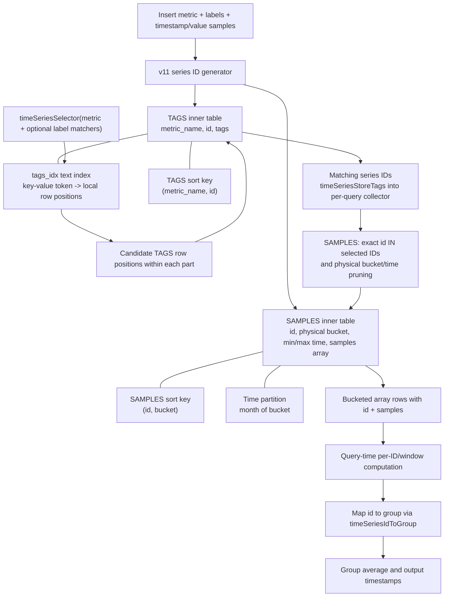
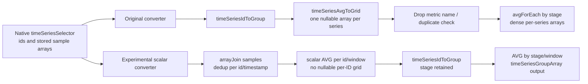

# ClickHouse TimeSeries: selector-based scalar grouped average

Source: ClickHouse pinned `52529f0c711566d696917678bf15e7068772fdde` and fork `moleus/ClickHouse` branch `lab/timeseries-fastpath-ci`. These diagrams describe the native v11 source and one experimental query rewrite. All identifiers and timestamps in the examples are illustrative.

## Storage, index lookup and query-time grouping

The `tags_idx` postings identify positions of rows **within a TAGS MergeTree part**. The rows contain the true v11 series IDs. The `SAMPLES` primary key then uses the series IDs and physical bucket. An index row position is not a series ID. The exact `id IN` check must remain: a primary-key range hint alone cannot guarantee correct label filtering.

## Original PromQL path versus guarded scalar lowering

The new path **does not flatten all samples directly into stage averages**. It first computes an average within each series and each window. The later `avg` across the group preserves equal weighting of series whose sample counts differ. Directly averaging all samples changes PromQL semantics when series have different numbers of observations.

## Physical bucket is not the evaluation window

| Layer | Example | Role |
| --- | --- | --- |
| Stored SAMPLES row | One series, bucket 10:00–11:00, samples at 10:02 and 10:15 | Unit of physical storage and partial range pruning |
| PromQL evaluation | `avg_over_time(metric[1d])` at midnight | Logical window **(previous midnight, midnight]** |
| Output | One scalar value per series/day, then stage group | The number of output points depends on query step, not stored bucket size |

A stored 4-hour sample bucket does not change a 1-day logical PromQL window; the selector slices the arrays to the requested sample time range. Overlapping evaluation windows would need separate handling and are **not enabled** in the first C++ candidate.

## Measured SQL prototype

Run [41419685211](https://github.com/moleus/ClickHouse/actions/runs/41419685211), 282,036 one-sample Jenkins series, original C++ query execution versus experimental SQL using native `timeSeriesSelector`. Same stored data, five queries, original/candidate/original; all outputs matched.

| Selector | Original repeat p50 | Scalar SQL p50 |
| --- | ---: | ---: |
| Exact metric only | 778 ms | 634 ms |
| `branch=main` | 303 ms | 257 ms |
| `project=project-00` | 124 ms | 130 ms |
| `stage=stage-0007` | 88 ms | 86 ms |
| `stage=~stage-000[0-9]` | 106 ms | 120 ms |

The C++ candidate intentionally targets **exact metric only**, because filtered queries had inconsistent results. It uses the same public table function as the original path, rather than joining raw inner TAGS and SAMPLES from the root SQL rewrite.

## Scope and correctness gates

- C++ patch: `.github/ts-lab-pending/apply_selector_scalar_grouped_avg_cpp.py`, source pinned to `52529f0c...`.
- Exact shape: `avg by(stage)(avg_over_time(exact_metric[1d]))` at 1-day step, v11 Float64, millisecond timestamp scale, compatible UTC timezone, no extra matchers, no `offset` or `@` or nested operations. Fallback is unchanged native converter.
- Build run: [41420384277](https://github.com/moleus/ClickHouse/actions/runs/41420384277).
- A/B/A run: [41420507321](https://github.com/moleus/ClickHouse/actions/runs/41420507321).
- Adversarial run: [41420683218](https://github.com/moleus/ClickHouse/actions/runs/41420683218).
- Native table-function read is more suitable for access control than direct inner reads, but policy/role equivalence remains to be tested explicitly.
- Need full 14–90 day data, late/back-delta, 15s HA dedup, higher cardinality, production `-O2/-O3` and ingestion/load tests before deployment.
