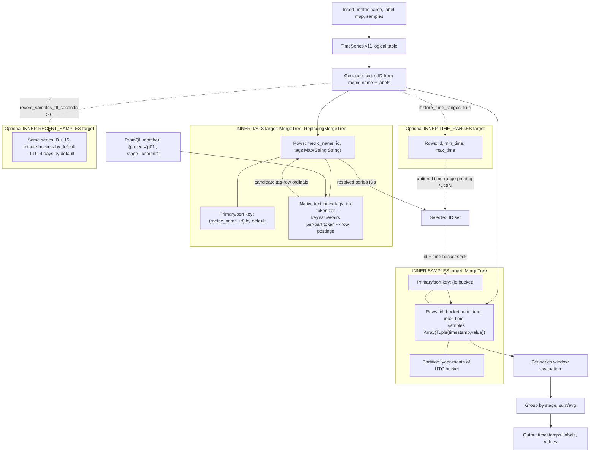
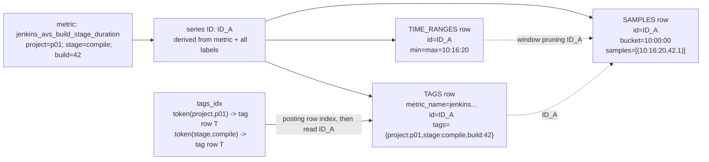
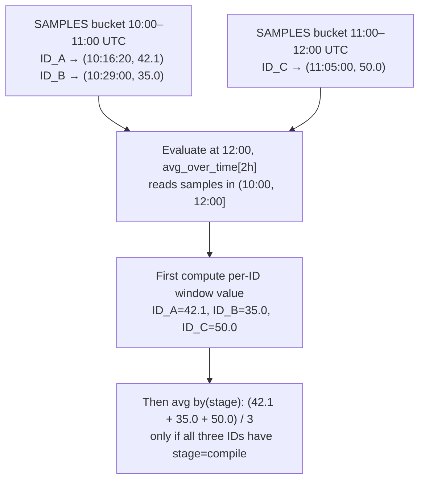
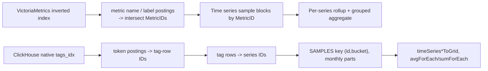

# ClickHouse TimeSeries v11: storage, indexes and time alignment

Source reference: ClickHouse pinned `52529f0c711566d696917678bf15e7068772fdde`, especially `src/Storages/TimeSeries/TimeSeriesSettings.cpp`, `normalizeTimeSeriesDefinitionImpl.cpp`, `StorageTimeSeriesSelector.cpp` and `src/Storages/MergeTree/MergeTreeIndexConditionText.cpp`.

The following diagrams describe the **engine source**, not a claim that the new C++ experiment is fast. Labels and IDs in the example are illustrative.

## 1. Logical data and physical indexes

**Index detail.** The built-in `tags_idx` exists in source; it is not an index added by our experiment. It uses `text(tokenizer=keyValuePairs)` on `tags`. It maps tokens to *row positions within a MergeTree data part*. Those positions identify matching tag rows. Tag rows carry series IDs, which locate samples through the **separate** samples-table primary key. A text-index row position is not itself a globally stable MetricID. The candidate patch tests whether `mapContainsKeyValue(tags, key, value)` activates the existing index more efficiently than `tags[key] = value`, while keeping the same exact row semantics.

**Data layout.** The default samples bucket is **3,600 seconds**. A bucket contains all samples of ONE series whose timestamps fall in that hour. The recent target uses **900-second buckets** by default and has a **345,600-second (4-day) TTL**, unless changed or disabled. The main samples target uses UTC calendar-month partitioning by default and a granularity of **256 bucket rows**. The default tags primary/sort key is `(metric_name,id)`; a custom `TAGS ORDER BY` can replace it, but benefits only compatible predicates.

## 2. Example: how the same ID connects three targets

When a Jenkins build produces **one point per series**, the tags and time_ranges metadata can dominate the cost. The value `42.1` is a sample value, not the numeric series ID. Multiple builds with different `build` labels have **different series IDs** even if they share the same `stage` label. Many IDs must be aggregated to produce one line per stage.

## 3. How bucket boundaries and evaluation windows align

The **stored bucket** is not an evaluation window. A 1h stored bucket is an IO unit; PromQL may need 5m, 2h or a 14-day sliding window. Samples exactly on the right edge of a Prometheus window are included; the left edge is excluded. Correct evaluation requires this boundary behavior, as well as duplicate-timestamp handling, NaN/staleness, reset/extrapolation for rate(), offsets, and groups with missing labels.

For `avg by(stage)(avg_over_time(m[1d]))`, use two stages: first compute the average **within each series and time window**, then average those per-series results across the group. Replacing it with a flat average over all raw samples changes the weights for series that contain different numbers of points. The direct C++ grouped-avg experiment tries to avoid carrying a full tag map and a dense grid through every intermediate aggregation state.

## 4. Comparison with VictoriaMetrics

The main distinction is *where* the index resolves to an ID and how the samples are organized. VictoriaMetrics postings directly list stable MetricIDs in an inverted index. ClickHouse text postings identify tag **rows inside parts**; then it must resolve those rows to series IDs and find samples. Neither approach eliminates the cost of per-series rollup. The new lab experiments target BOTH the label predicate and the intermediate grouped-aggregate work.

## Measured constraints, not yet solved

- Earlier cross-engine benchmark: 282,036 one-sample Jenkins series, default CH TimeSeries grouped `avg` p50 about 1.5 seconds, VM about 0.5–0.6 seconds.
- Same TimeSeries inner targets with separate SQL per-series grouped avg gave 476 ms p50 and ~128 MB query memory; direct C++ implementations are not yet this fast.
- Original C++ direct inner scalar argMax path p50 803 ms in one A/B/A run but the following native groupArray variant p50 1,758 ms in a different A/B/A run.
- New experiments: late tags join after per-series/window aggregation (remove Map from GROUP BY keys) and direct exact `mapContainsKeyValue` for the existing text index.
- Regular dense metric processing, 13.4M live series, 650–800K samples/s, 500+ new series/s, 15s HA dedup and late writes remain mandatory production gates.
